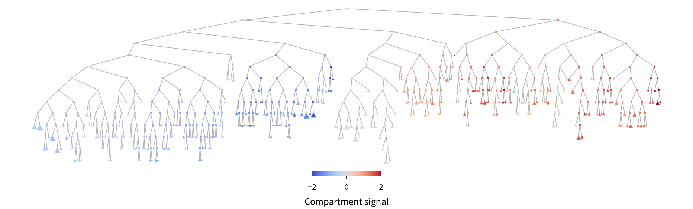

# TADCLUST - Hierarchical clustering of TADs

Given any TAD annotation and a contact map, TADCLUST applies hierarchical clustering of the TADs based on TAD-level O/E matrix, to build a tree on each chromosome. The clustering analysis identifies a higher-order organization of locally-defined TADs, which is correlated to chromosome compartmentalization.



## Install

TADCLUST is experimental and not released yet. Git clone, and use uv to try it out:

```shell
$ git clone https://github.com/snsinfu/tadclust.git
$ cd tadclust
$ uv run tadclust -h
````

Or, use docker (currently not regularly updated):

```
$ docker run --rm ghcr.io/snsinfu/tadclust tadclust -h
```

## Usage

Give an mcool contact matrix, a TAD annotation table, optionally an A/B feature track, and the output directory.

```shell
$ tadclust \
  --output-dir       out \
  --mcool            contact_map.mcool \
  --tad-table        tad_annotation.bed \
  --ab-feature-track active_signal.bedGraph
```

The TAD table can be any disjoint or hierarchical TAD annotation in the BED3+ format, or a TSV with `chrom, start, end` columns. TADCLUST selects an optimal set of sub-TADs for clustering if the annotation is hierarchical. `--ab-feature-track` is any 4-column, BedGraph-like table or BED5+ where the annotated score is larger in the A compartment (like ATAC, H4ac, and gene density). It is used to define the A/B compartment boundary, to enable A/B annotation of TADs and cluster nodes.

### Options

| option              | default | description |
|:--------------------|:--------|:------------|
| --tree-branch-k  K  | 2       | Split count of recursive k-means. |
| --with-trans        | no      | Enable trans-chromosomal clustering (experimental and expensive). |
| --with-residuals    | no      | Fill gaps with `residual` pseudo-domains. |
| --overwrite         | no      | Allow overwriting existing files in the output directory. |
| --workers        N  | 1       | Run analysis in parallel using N processes. |
| --seed           N  | 0       | Random seed for reproducibility. |

### Output

Results are stored as parquet/tsv tables and a json summary in the output directory:

```
out/
├── cis_nodes.parquet
├── cis_nodes_ab.parquet        # optional
├── cis_leaves.parquet
├── cis_leaves.tsv
├── cis_leaves_ab.parquet       # optional
├── cis_leaves_ab.tsv           # optional
├── trans_nodes.parquet         # optional
└── manifest.json
```

Main output is `cis_nodes.parquet` which contains full tree nodes for all chromosomes. `cis_leaves.{parquet,tsv}` are leaf-only subsets created for convenience. `_ab` suffixed tables store the result for A/B-rooted clustering variant. Columns:

| column            | type             | description |
|:------------------|:-----------------|:------------|
| chrom             | string           | The chromosome the node belongs to. |
| node_id           | int              | Unique ID of the node within the table. |
| parent_id         | int              | Parent's node_id or null. |
| child_ids         | int[]            | Children's node_ids or empty. |
| depth             | int              | Depth of the node, 0 = root. |
| is_leaf           | bool             | (leaf) True or (branch) false. |
| unit_id           | int              | (leaf) Unique ID of the clustered leaf unit or (branch) null. |
| unit_kind         | tad/residual/bin | (leaf) Type of the unit or (branch) null. |
| unit_start        | int              | (leaf) Start coord of the unit or (branch) null. |
| unit_end          | int              | (leaf) End coord of the unit or (branch) null. |
| tad_table_row     | int              | (leaf) Row index of the TAD table or (branch/non-TAD) null. |
| root_label        | chrom/A/B/genome | Root of the tree the node belongs to. |
| path              | int[]            | Branches to take to arrive at the node from the root, like \[0,1,0,1,1,1\]. |
| path_label        | string           | Root + path as a dot-delimited string, like "chrom.0.1.0.1.1.1". |
| ab_label          | A/B              | A/B classification (ab_signal <=> 0) of the node. |
| ab_signal         | float            | A/B compartment signal for the node. |
| ab_frac_a         | float            | Fraction of A leaves under the node. |
| ab_frac_b         | float            | Fraction of B leaves under the node. |
| ab_purity         | float            | Max(ab_frac_a, ab_frac_b). |
| pc                | float[]          | (leaf) PC feature vector or (branch) centroid. |
| n_units           | int              | Number of units under the node. |
| n_working_bins    | int              | Number of working bins covered by the units under the node. |
| node_oe           | float            | Mean log2 O/E over all units and unit pairs under the node. |
| node_internal_sse | float            | Feature-space SSE of leaves under the node. |
| node_split_gain   | float            | Relative SSE cost of splitting at this node. |
| stop_reason       | degenerate       | Reason of abruptly stopped splitting or null. |

Notes:

- Node's children (.0 .1) are ordered by centroid PC1.
- When `--ab-feature-track` is given, the PC1 axis itself is oriented towards higher A signal. So nodes are B-to-A ordered.
- In the tsv outputs, array/list columns are not emitted, and nulls are replaced by (int) -1, (float) NaN, and (string) "NA".

## Method notes

**TAD-level L2-normalized log-O/E** is diagonalized (without centering; zero is the natural center for log-O/E) to produce principal components. This PC feature space is hierarchically clustered like CALDER. The first branch gives a similar result to the conventional compartment analysis, and deeper branches describe subcompartment organization.

When **hierarchical TAD annotation** is given (i.e., there are nested intervals), the optimal levels of sub-TAD hierarchies are decided by dynamic programming so that within-TAD variance (among sub-TADs and gaps) is minimized in the feature space. The selected (sub-)TADs are output as leaf units with `unit_kind` = "tad". Besides clustering, this selection of the "most coherent" sub-TADs can be useful on its own.

**Recursive K-means** seems superior to other methods like Ward, HDBSCAN, spectral, etc. for clustering TADs. This is probably because the domains in the feature space are not cleanly separable (strong noise, broad lobes, and biological intermediates). Bisection (k=2) is good enough to maintain A/B coherence in subtree. k=3 performs similarly good.

For **A/B compartment** annotation, an auxiliary binary split of an augmented feature space is made. Bisection of the raw PC space does not reliably give a useful "A/B"-like clusters except for mammalian datasets, so the PC space needs to be augmented by a reference signal track (`--ab-feature-track`; ATAC, H4ac, and gene density tracks work well) to determine the A/B decision boundary and the orientation. Once the boundary is determined, it is projected onto the original PC space, and the TADs are A/B-annotated. This auxiliary split is done solely for annotation and it does not affect the cluster hierarchy.

The **A/B signal** is the 1D projection of the node's PC centroid onto the A-B axis in the PC space (the axis along the A and B centroids). This is a generalization of the conventional PC1 compartment signal to the bisected, higher-dimensional PC space. The magnitude of the signal is informative: it is the distance from the decision boundary, so close-to-zero signal indicates poor compartmentalization. The PC space is standardized in A/B analysis, so the typical values of the signal distribute in the ~3 sigma range, or within approximtely \[-3,3\], so the "normal" magnitude would be around ~1.

**Genome-wide clustering** (experimental) is also done when `--with-trans` flag is passed. Genome-wide, trans-chrom O/E is built using the cis-defined TADs as units, diagonalized, and recursively clustered. The trans tree tends to capture chromosome territories or telomere clustering rather than genome-wide A/B compartments. Still, the `unit_id` is shared between the cis table, so one can JOIN cis and trans tables to examine cis-determined A/B on the trans tree.

## AI disclosure

LLM coding agent is used for development. Algorithm is designed and instructed by me, then implemented by AI, benchmarking on real datasets. I review every changeset and adjust it until it looks fine. This README is 100% human-written.

## License

MIT
